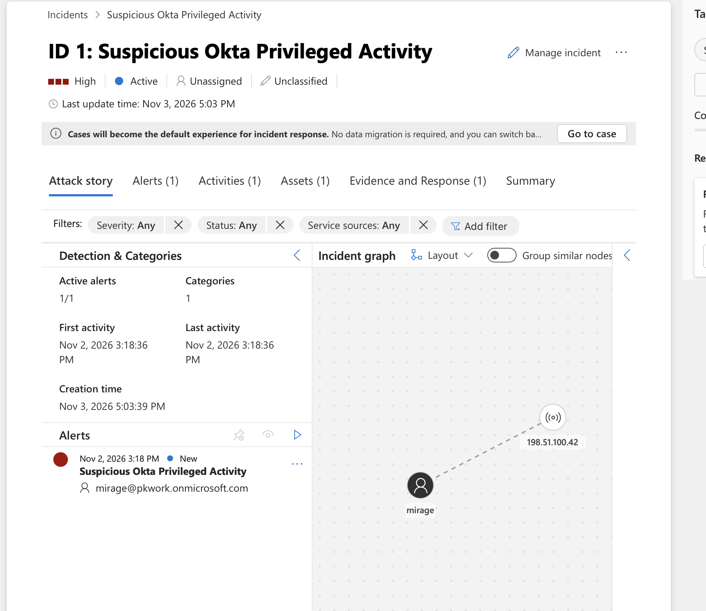
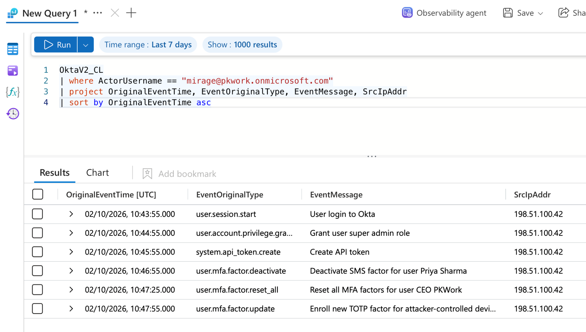
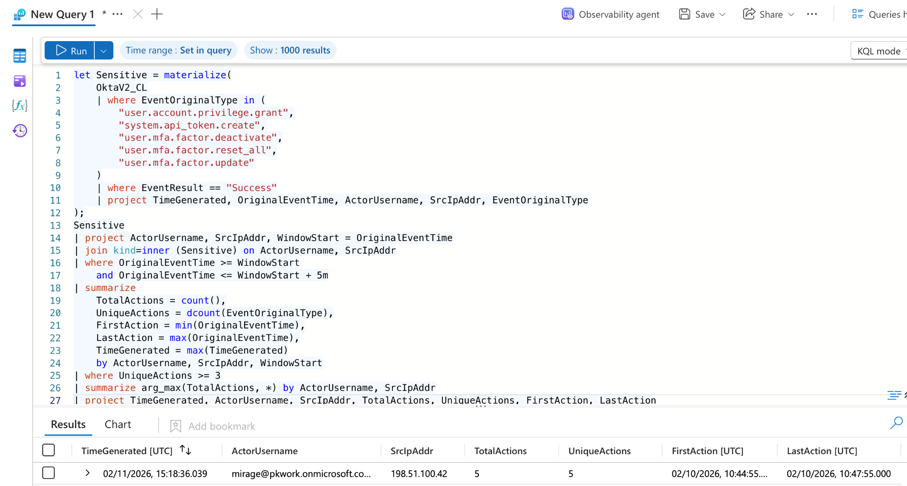
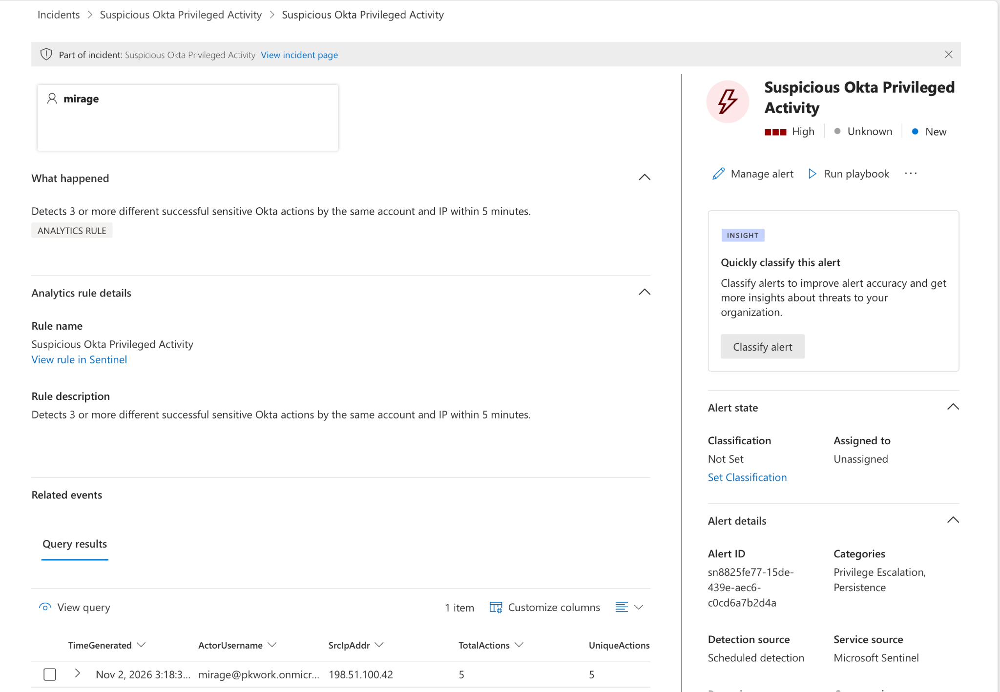
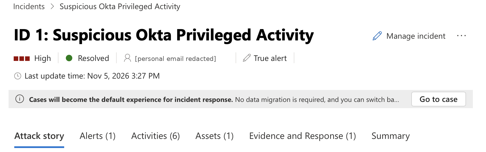

# Microsoft Sentinel SOC Investigation: Okta Privileged-Account Activity

I investigated suspicious Okta account activity using Microsoft Sentinel, then built a KQL rule that generated an alert and Incident #1. The data came from Microsoft's Sentinel Training Lab, not a live attack.

## At a glance

| Part | Result |
|---|---|
| Data | 36 events in `OktaV2_CL`; 9 Okta event types identified |
| Main finding | Mirage performed 5 different sensitive actions in 3 minutes |
| Detection | Rolling five-minute KQL rule, checked with positive and negative synthetic tests |
| Sentinel | 1 generated alert and Incident #1, with account and IP entities |
| Triage | High severity; classified as True alert and marked Resolved |



*Incident #1 as Sentinel created it on 3 November, before triage. The resolved state is shown further down.*

## Why I built this

I wanted hands-on Sentinel experience with real log data rather than just reading about SIEMs. I investigated unfamiliar Okta logs, then built a rule to detect the same behaviour.

## Architecture

```text
Microsoft Sentinel Training Lab Okta CSV
                │
         Local CSV → JSON
                │
 Azure Monitor Logs Ingestion API
                │
       DCE → DCR transform
       TimeGenerated = now()
                │
       Log Analytics: OktaV2_CL
                │
       KQL investigation & tests
                │
     Sentinel scheduled analytics rule
                │
       Alert → Incident #1
```

The setup used an Azure Data Collection Endpoint (DCE), Data Collection Rule (DCR), Entra app registration, Log Analytics workspace and Sentinel. No licensed Defender XDR workload telemetry was used.

The simulated activity took place on 2 October 2026, and the logs were ingested on 2 November 2026. `OriginalEventTime` was used for the investigation timeline and `TimeGenerated` for the rule's ingestion lookback. The [pipeline notes](ingestion/pipeline.md) explain the setup.

## Investigation

The first lead was a successful reset of the CEO's MFA factors. The actor was `mirage@pkwork.onmicrosoft.com`, using `198.51.100.42`. That address is in the reserved TEST-NET-2 range, so I treated it as a lab IP instead of running real-world reputation checks.

Mirage's activity showed this sequence:

| Time (UTC), 2 October | Successful event | Target |
|---|---|---|
| 10:43:55 | Okta session start | Salesforce app user |
| 10:44:55 | Super-admin role grant | Mirage |
| 10:45:55 | API token creation | Token labelled `Backdoor API Token` |
| 10:46:55 | SMS MFA deactivation | Priya Sharma |
| 10:47:25 | Reset of all MFA factors | CEO PKWork |
| 10:47:55 | TOTP enrolment | Mirage |

Log Analytics screenshots use DD/MM/YYYY (02/10/2026 = 2 October).



The training data labels the token `Backdoor API Token` and the TOTP device as attacker-controlled. My detection checks event types, outcomes and timing, not those labels.

Priya had 13 events from 13 IPs, but every account except Mirage had a different IP on each event. That looked more like a dataset pattern than a reliable indicator, so I left IP diversity out of the detection. See the [incident report](report/incident-report.md).

## Detection

The aim was to catch a cluster of sensitive actions rather than trigger every time an administrator changed an MFA factor. The condition was at least three different successful sensitive event types from the same actor and IP within five minutes.

The first query had no time limit. Next, I tried `bin(OriginalEventTime, 5m)`, but it returned 4 actions instead of 5: the 10:44:55 event went into 10:40–10:45, and the next four into 10:45–10:50.

That was the most useful problem I hit. Switching to a rolling five-minute window, with each event as a possible starting point, picked up all 5 actions between 10:44:55 and 10:47:55.

Another revision was missing `OriginalEventTime >= WindowStart`. I spotted the mistake and restored the lower time bound.



The detection was checked against these cases:

| Test | Recorded result |
|---|---|
| Mirage's recorded activity, five-minute window | 5 actions / 5 types |
| Same activity, 20-second window | 0 matches |
| Three different actions spread over 14 minutes | 0 matches |
| Three different actions within 3 minutes | 3 actions / 3 types |
| Three identical actions within 3 minutes | 0 matches |

The tests used `datatable()` without ingesting logs. The [test files](tests/README.md) were rebuilt from recorded inputs and results, not saved from the editor. They copy the detection logic rather than call the deployed rule directly.

[Deployed KQL](queries/04-detection-deployed.kql) · [Rule export](detection/rule-export-sanitized.json) · [Detection notes](detection/engineering-notes.md)

## What Sentinel actually generated

The scheduled rule was configured with High severity, account and IP entity mapping, and a daily run with a three-day lookback for the historical training data.

On 3 November 2026, Sentinel generated one alert and Incident #1. The alert showed `TotalActions = 5` and `UniqueActions = 5`.



After reviewing the alert, I added my investigation note, classified the incident as True alert and marked it Resolved on 5 November 2026. Containment was recommended for an equivalent real incident; no action was taken against real accounts. The rule was disabled after capturing the result.



## Limitations

- The 36-event sample is too small to establish normal behaviour or a detection success rate, and some messages give away the scenario.
- Requiring the same IP could miss an actor switching networks.
- Duplicate timestamps can inflate `TotalActions`; legitimate admin work could also match the rule.
- The logs didn't establish Mirage's initial access, lasting admin permissions, token use or data theft.

The [engineering notes](detection/engineering-notes.md) cover all eight detection limitations, including the schedule, distinct-count estimate, burst selection and event grouping.

## Files

| Contents | Where to find them |
|---|---|
| Validation and exploration | [Queries](queries/README.md), [screenshots](screenshots/README.md) |
| Account investigation | [Investigation KQL](queries/03-investigation.kql), [incident report](report/incident-report.md) |
| Detection and tests | [Deployed query](queries/04-detection-deployed.kql), [tests](tests/README.md), [engineering notes](detection/engineering-notes.md) |
| Sentinel alert and triage | [Rule export](detection/rule-export-sanitized.json), [Tier 1 note](report/tier1-triage-note.md) |
| Ingestion | [Pipeline notes](ingestion/pipeline.md) |

## Sources, assistance and cleanup

The logs came from [Microsoft's Sentinel Training Lab Okta CSV](https://github.com/Azure/Azure-Sentinel/blob/master/Tools/Microsoft-Sentinel-Training-Lab/Artifacts/Telemetry/Custom/OktaV2_CL.csv). I used the [Sentinel scheduled-rule documentation](https://learn.microsoft.com/en-us/azure/sentinel/scheduled-rules-overview) as a reference.

This was an AI-guided project. I wrote the investigation queries myself, with AI correcting my mistakes along the way, and made the analysis and triage decisions. The rolling-window detection and much of the documentation were developed with AI help.

After exporting evidence, I deleted the client secret, app registration and lab resource group. On 5 November 2026, Azure CLI confirmed no active resources remained. The last visible cost was £0.00.
